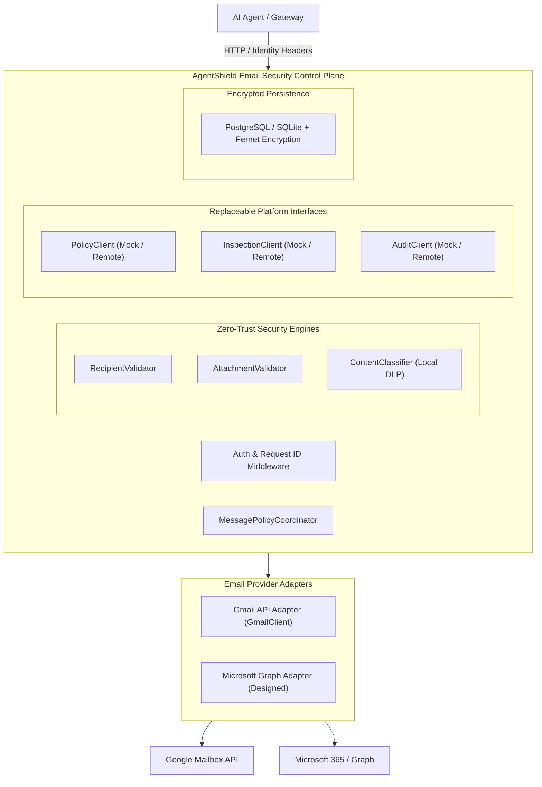

# AgentShield Email Security

Independent deployable foundation for **AgentShield Module 2: Email Security Gateway**.

Allows authorized AI agents to interact with corporate email accounts (Google Gmail API and Microsoft Graph) through controlled, policy-governed APIs with zero-trust token isolation, outbound data loss prevention (DLP), recipient and attachment validation, and centralized audit logging.

---

## Architecture Overview



### Core Security Boundaries
- **No Token Exposure to Agents**: AI agents never receive OAuth access tokens, refresh tokens, or passwords. Tokens are stored encrypted at rest using Fernet (AES-128-CBC + HMAC-SHA256).
- **Least-Privilege Scopes**: Defaults to read-only OAuth scopes (`gmail.readonly`). Write/send actions require explicit granted scopes, verified by the policy engine before dispatch.
- **Outbound Data Loss Prevention (DLP)**: Outbound emails and drafts are evaluated for credit card numbers (verified with Luhn algorithm), SSNs, cloud API keys, and private keys.
- **Recipient Hygiene & Boundary Enforcement**: RFC 5322 syntax validation, CRLF injection prevention, disposable domain detection, and homoglyph / punycode attack mitigation.
- **Attachment Defense**: Blocks executable extensions (`.exe`, `.sh`, `.vbs`, etc.), double-extension deception (e.g., `invoice.pdf.vbs`), and enforces strict size limits.
- **Fail-Closed Design**: If a required policy, DLP, or audit service becomes unreachable, outbound actions are immediately blocked.
- **Replaceable Interfaces**: Full interface contracts for `PolicyClient`, `InspectionClient`, and `AuditClient` with safe, explicit development mocks (`mocks/`).

---

## Project Structure

```
agentshield-email-security/
├── app/
│   ├── api/                  # FastAPI HTTP route handlers
│   │   ├── email_routes.py   # Core email operations (read, search, draft, send, forward)
│   │   ├── oauth_routes.py   # Google OAuth 2.0 start, callback, revocation
│   │   └── health_routes.py  # Service health check
│   ├── config.py             # Pydantic v2 settings & Fernet crypto setup
│   ├── database/             # SQLAlchemy 2 models, session, and repository
│   │   ├── models.py         # OAuthAccount, OAuthState, AuditRecord, Approval
│   │   ├── repository.py     # Field-level token encryption data access
│   │   └── session.py        # Async engine & session lifecycle
│   ├── integrations/         # Replaceable platform interface contracts
│   │   ├── policy_client.py  # BasePolicyClient & HttpPolicyClient
│   │   ├── inspection_client.py # BaseInspectionClient & HttpInspectionClient
│   │   └── audit_client.py   # BaseAuditClient & HttpAuditClient
│   ├── middleware/           # HTTP middleware
│   │   ├── authentication.py # Gateway caller context & identity verification
│   │   └── request_id.py     # Distributed correlation request ID
│   ├── providers/            # Mailbox provider adapters
│   │   ├── base.py           # BaseEmailProvider abstract interface
│   │   ├── gmail/            # Gmail REST client, OAuth handler, message parser
│   │   │   ├── client.py
│   │   │   ├── message_parser.py
│   │   │   └── oauth.py
│   │   └── microsoft/        # Microsoft Graph adapter (interface ready)
│   │       └── client.py
│   ├── schemas/              # Pydantic request, response, and security schemas
│   │   ├── approval.py
│   │   ├── email.py
│   │   └── security.py
│   ├── security/             # Local security validators & orchestrator
│   │   ├── attachment_validator.py
│   │   ├── content_classifier.py
│   │   ├── message_policy.py
│   │   ├── recipient_validator.py
│   │   └── token_crypto.py
│   └── main.py               # FastAPI application entrypoint
├── mocks/                    # Development-only mocks (clearly marked)
│   ├── mock_audit.py
│   ├── mock_inspector.py
│   └── mock_policy.py
├── tests/                    # Comprehensive Pytest test suite
│   ├── conftest.py           # In-memory async SQLite fixtures & client
│   ├── unit/                 # Unit tests (validators, classifier, parser, crypto)
│   ├── integration/          # API endpoint & OAuth flow integration tests
│   └── security/             # Scope enforcement, tenant isolation, fail-closed tests
├── docs/                     # Technical specifications
│   ├── api.md
│   ├── architecture.md
│   ├── integration.md
│   └── security.md
├── examples/
│   └── demo_email_agent.py   # Working agent demonstration script
├── alembic/                  # Database migrations
│   ├── versions/
│   │   └── 001_initial_email_security_schema.py
│   └── env.py
├── alembic.ini
├── docker-compose.yml
├── Dockerfile
├── requirements.txt
├── .env.example
├── .gitignore
└── README.md
```

---

## Prerequisites

- **Python**: 3.11 or newer
- **PostgreSQL**: 15+ (in production) or **SQLite** (built-in fallback for local testing)
- **Docker & Docker Compose**: Optional for containerized deployment

---

## Local Setup

### 1. Clone & Environment Configuration

```bash
cd agentshield-email-security
cp .env.example .env
```

Edit `.env` as appropriate. For local development with mocks, default settings work out of the box.

### 2. Virtual Environment & Dependencies

```bash
python3 -m venv .venv
source .venv/bin/activate
pip install -r requirements.txt
```

### 3. Database Migrations

Run database migrations to initialize tables:

```bash
alembic upgrade head
```

### 4. Start Development Server

```bash
uvicorn app.main:app --host 0.0.0.0 --port 8001 --reload
```

Interactive API documentation will be available at:
- Swagger UI: `http://localhost:8001/docs`
- Health check: `http://localhost:8001/health`

---

## Running Tests

Execute the full suite of unit, integration, and security tests:

```bash
PYTHONPATH=. pytest tests -v
```

All 43 tests cover:
- Inbound prompt injection & phishing detection
- Outbound credit card (Luhn algorithm), SSN, and API key DLP scanning
- Dangerous attachment extensions (`.exe`, `.vbs`, etc.) and double-extension spoofing
- RFC 5322 recipient validation, CRLF injection prevention, and disposable domain blocking
- OAuth 2.0 CSRF state validation, anti-replay, and zero token leakage
- Scope enforcement (read-only accounts blocked from sending/drafting)
- Tenant and agent identity isolation boundaries
- Fail-closed behavior when remote security services are unavailable

---

## Containerized Deployment (Docker Compose)

Start the email security API and PostgreSQL database with a single command:

```bash
docker compose up -d --build
```

To view logs:
```bash
docker compose logs -f email-security-api
```

---

## Running Example Agent Demo

With the server running on `http://localhost:8001`:

```bash
python3 examples/demo_email_agent.py
```

---

## Technology Stack

- **Framework**: FastAPI, Starlette
- **Data Validation**: Pydantic v2, Pydantic-Settings, Email-Validator
- **Database**: SQLAlchemy 2 (Asyncio), Alembic, asyncpg, aiosqlite
- **Security & Crypto**: Cryptography (Fernet symmetric encryption)
- **HTTP Clients**: HTTPX (Asynchronous)
- **Email Adapters**: Google OAuth 2.0, Gmail REST API, Google API client
- **Testing**: Pytest, Pytest-Asyncio, HTTPX ASGI Transport

