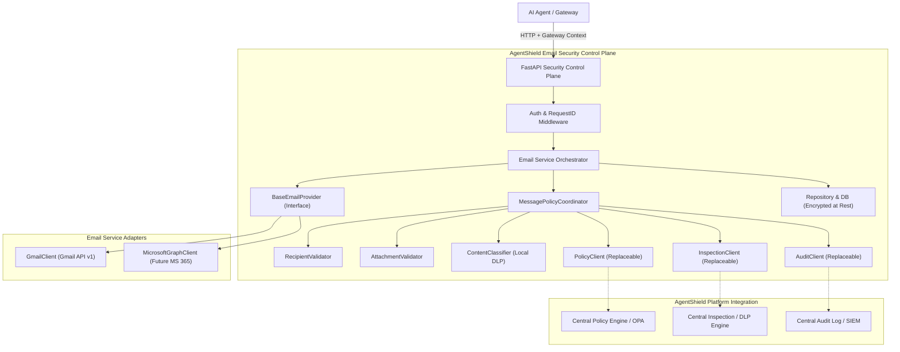
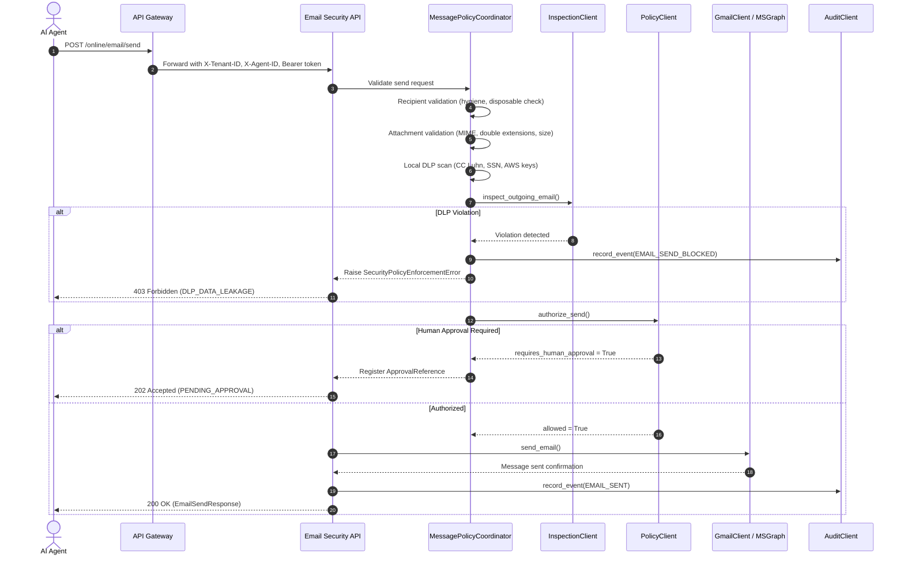
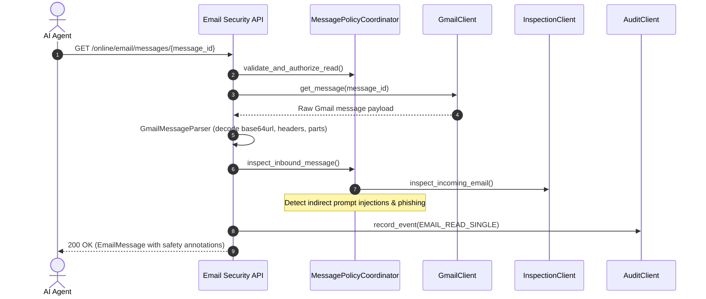

# AgentShield Email Security — Architecture Specification

`agentshield-email-security` is an independently deployable component providing secure, controlled email integration for authorized AI agents within the AgentShield platform (Module 2).

## 1. System Topology & Architectural Boundaries

### Architectural Boundaries
1. **API Boundary**: FastAPI exposes REST endpoints. Provider-specific types, token strings, and internal credentials never escape this layer.
2. **Identity Boundary**: The service never trusts agent-supplied tenant or agent identities. Identity is derived strictly from authenticated gateway headers (`X-Tenant-ID`, `X-Agent-ID`, `Authorization`).
3. **Security Coordination Boundary**: Every action traverses `MessagePolicyCoordinator`. Local checks (syntax, extensions, regex, Luhn algorithm) execute first, followed by centralized external policy and DLP calls.
4. **Provider Isolation Boundary**: All mail interaction occurs via `BaseEmailProvider`. Neither route handlers nor business services import or reference Google- or Microsoft-specific client APIs directly.
5. **Persistence Boundary**: Field-level token encryption protects credentials at rest with Fernet (AES-128-CBC + HMAC-SHA256).

---

## 2. Inbound & Outbound Data Flows

### Outbound Transmission (Send / Forward) Flow

### Inbound Reading Flow

---

## 3. Database Schema

Managed via SQLAlchemy 2 and Alembic:

- **`oauth_accounts`**:
  - `id` (UUID, PK)
  - `tenant_id` (String, Index)
  - `agent_id` (String, Index)
  - `provider` (String: `google`, `microsoft`)
  - `account_email` (String, Index)
  - `encrypted_access_token` (Text, Fernet encrypted)
  - `encrypted_refresh_token` (Text, Fernet encrypted)
  - `token_expiry` (DateTime, TZ)
  - `granted_scopes` (JSON)
  - `status` (String: `active`, `revoked`, `expired`)
  - `created_at`, `updated_at` (DateTime, TZ)

- **`oauth_states`**:
  - `state_token` (String, PK, cryptographically random + HMAC signed)
  - `tenant_id`, `agent_id`, `provider`, `requested_scopes`, `redirect_uri`
  - `expires_at` (DateTime, 10 min TTL)
  - `used` (Boolean, single-use anti-replay)

- **`email_audit_records`**:
  - `id` (UUID, PK)
  - `tenant_id`, `agent_id`, `account_id`
  - `event_type` (`EMAIL_READ`, `EMAIL_SENT`, `DLP_LEAKAGE_BLOCKED`, etc.)
  - `status` (`ALLOWED`, `BLOCKED`, `FLAGGED`, `ERROR`)
  - `policy_decision_id`, `inspection_reference_id`
  - `metadata_json` (Sanitized parameters: recipient domains, count, message ID; no bodies or secrets)
  - `timestamp` (DateTime, TZ)

- **`approval_references`**:
  - `id` (UUID, PK)
  - `tenant_id`, `agent_id`, `action_type`, `target_resource`
  - `status` (`PENDING`, `APPROVED`, `REJECTED`, `EXPIRED`)
  - `reason`, `payload_summary`
  - `approved_by`, `created_at`, `expires_at`

